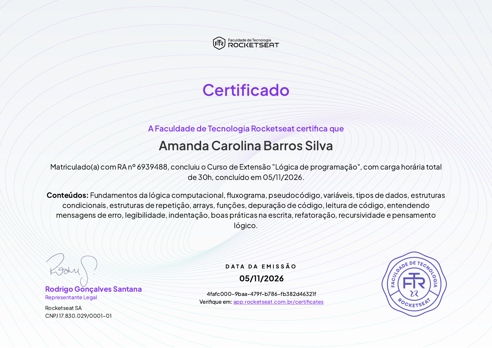
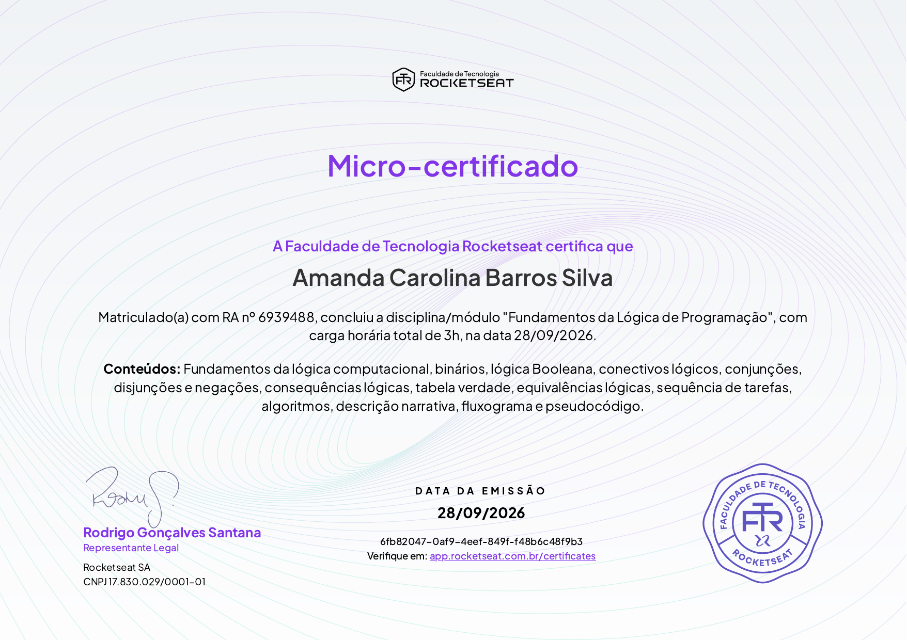

# Formação Lógica de Programação

Exercícios e anotações da formação de Lógica de Programação da [Rocketseat](https://www.rocketseat.com.br) (30 horas, 7 níveis), concluída em novembro de 2026.

Os níveis 1 e 2 tinham desafios práticos, e as minhas soluções estão nas pastas abaixo. Do nível 3 ao 6 a formação foi só de aulas e avaliações, então aqui registro o que estudei em cada um.

## Níveis

**1. Fundamentos da Lógica de Programação**
Lógica booleana, conectivos e tabela-verdade, e as formas de representar um algoritmo: descrição narrativa, fluxograma e pseudocódigo.
Exercícios: [conectivos e tabela-verdade](./conectivos-e-tabela-verdade) e [representação de algoritmos](./representacao-de-algoritmos).

**2. Escrevendo o primeiro programa**
Preparar o ambiente e escrever os primeiros programas em Python, com variáveis, condicionais, laços e funções.
Exercícios: [primeiros programas](./primeiros-programas), oito programas pequenos, de jogo de adivinhação a caça ao tesouro.

**3. Lendo, depurando e entendendo código**
Como ler um código que outra pessoa escreveu, acompanhar o que acontece em cada linha durante a execução e usar as ferramentas de depuração para achar e corrigir erros.

**4. Boas práticas e legibilidade**
Indentação, organização visual, nomes claros e os primeiros passos em refatoração: melhorar um código que já funciona para que fique mais fácil de entender e de manter.

**5. Desafios de raciocínio lógico**
Problemas clássicos para treinar a forma de pensar, como a Torre de Hanói e o Sapo na Lagoa, passando por recursividade e por como analisar decisões e possibilidades.

**6. Estrutura de dados**
Dividido em duas partes. Na introdução, aprofundei os tipos de dados e trabalhei com listas, tuplas, dicionários e conjuntos, incluindo manipulação mais avançada dessas estruturas. Na parte avançada vieram pilhas, filas, listas encadeadas, heaps e hashes.

**7. Certificado final**
Emitido em 05/11/2026.

## O que ficou

- Tabela-verdade com 2, 3 e 5 proposições, e como os conectivos viram `and`, `or` e `not` no código
- Representar um algoritmo de três jeitos e conferir com teste de mesa
- Python básico: `input` e `print`, f-strings, `if`/`elif`/`else`, `match`/`case`, `for`, `while`, listas, funções e `try`/`except`
- Ler e depurar código em vez de reescrever tudo quando algo dá errado
- Escrever pensando em quem vai ler depois, inclusive eu mesma
- Escolher a estrutura de dados pelo problema, das mais simples, como listas e dicionários, até pilhas, filas, heaps e hashes

## Certificados

Certificado final da formação, emitido pela Faculdade de Tecnologia Rocketseat em 05/11/2026:

Para verificar: [app.rocketseat.com.br/certificates](https://app.rocketseat.com.br/certificates), código `4fafc000-9baa-479f-b786-fb382d46321f`

Micro-certificado do nível 1, Fundamentos da Lógica de Programação, emitido pela Faculdade de Tecnologia Rocketseat em 28/09/2026:

Para verificar: [app.rocketseat.com.br/certificates](https://app.rocketseat.com.br/certificates), código `6fb82047-0af9-4eef-849f-f48b6c48f9b3`

---

Amanda Carolina · [LinkedIn](https://www.linkedin.com/in/amanda-carolina-bs)
